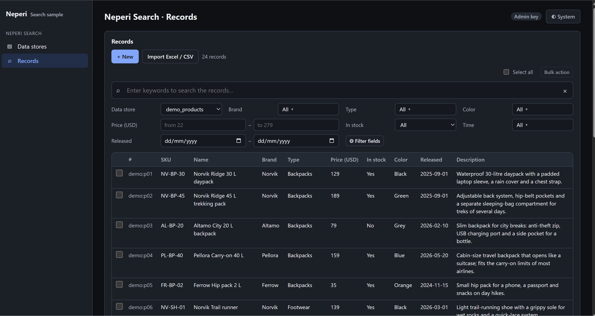
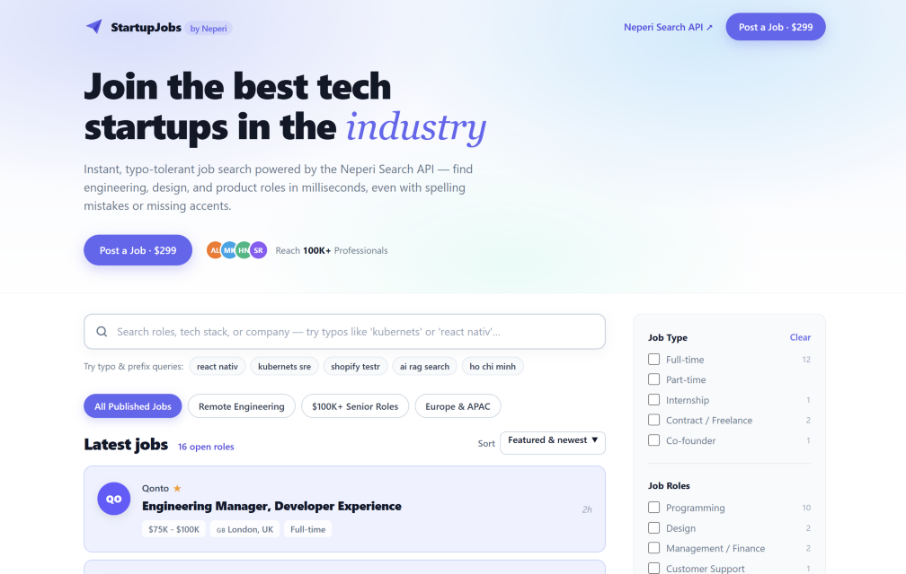

# Neperi Search — Starter Client & Mini Console

A zero-dependency web search UI and lightweight data manager for **[Neperi Search](https://neperi.com)** — the multilingual, typo-tolerant, and OCR-resilient full-text search API.

**[Website](https://neperi.com)** · **[API Reference](https://neperi.com/docs.html)** · **[Get Free API Key](https://app.neperi.com/app#signup)** · **[For AI Agents (`llms.txt`)](https://neperi.com/llms.txt)**



---

## Starter Templates & Use-Case Demos

Explore ready-to-run templates built on the public **Neperi Search REST API** to see how instant typo-tolerant & faceted search fits different products:

| Console & Catalog Table (`neperi-search-client`) | Tech Startup Job Board (`neperi-job-board`) |
|---|---|
| <a href="https://github.com/neperisearch/neperi-search-client"></a> | <a href="https://github.com/neperisearch/neperi-job-board"></a> |
| **This repository** — Multi-store search UI, Excel/CSV data grids, 3-color match highlights, and optional local data manager (`NEPERI_WRITE=1`). | **[neperi-job-board →](https://github.com/neperisearch/neperi-job-board)** — Job board landing page with typo-tolerant role/skill search, featured listings, and faceted filters (*Job Type, Role, Remote, Salary, Location*). |

---

## Quick Start

Requires **Node.js 18+** (uses built-in modules only — no `npm install` needed).

1. Sign up at **[app.neperi.com](https://app.neperi.com/app#signup)** and create a key under **Account → My keys**.  
   *(Every new account includes sample stores — `demo_products`, `demo_support`, and `demo_code` — so you can test immediately.)*

2. Clone and start the server:

   **macOS / Linux:**
   ```bash
   git clone https://github.com/neperisearch/neperi-search-client.git
   cd neperi-search-client

   # Public search mode (read-only)
   NEPERI_API_KEY=your_api_key node server.mjs

   # Local console mode (manage stores, records & Excel/CSV imports)
   NEPERI_API_KEY=your_api_key NEPERI_WRITE=1 node server.mjs
   ```

   **Windows (PowerShell):**
   ```powershell
   $env:NEPERI_API_KEY="your_api_key"; $env:NEPERI_WRITE="1"; node server.mjs
   ```
   *(Or put `NEPERI_API_KEY=your_api_key` in a `.env` file and run `node --env-file=.env server.mjs` on Node 20.6+.)*

3. Open **<http://localhost:8080>** in your browser.

---

## Features

- **Search as you type:** Handles typos, missing accents, prefix letters (`no ri 30` → *Norvik Ridge 30 L*), and match highlighting.
- **Faceted filters:** Filter by category, custom fields (lists, statuses, number/date ranges, booleans), tags, and dates.
- **Domains:** Named sets of conditions a store keeps to — always applied (e.g. only published records), or a box visitors pick.
- **Document & table views:** Displays text records as cards and imported Excel/CSV files as interactive tables.
- **Local admin mode (`NEPERI_WRITE=1`):** Create stores, add/edit records, import `.xlsx` / `.csv` files, and run bulk actions.

---

## Configuration

| Variable | Description | Default |
|---|---|---|
| `NEPERI_API_KEY` | Your Neperi API key (**required**) | — |
| `NEPERI_WRITE` | `1` enables creating, editing, importing, and deleting data *(filter field setup requires an admin key)* | Off *(search only)* |
| `NEPERI_COLLECTIONS` | Comma-separated store names exposed on this page, or `*` for all stores | `demo_support,demo_products,demo_code` *(`*` when `NEPERI_WRITE=1`)* |
| `NEPERI_URL` | Neperi API base URL | `https://app.neperi.com` |
| `PORT` | Local HTTP port | `8080` |
| `HOST` | Bind address | `127.0.0.1` with `NEPERI_WRITE=1`, else all interfaces |
| `FACETS_TTL` | Cache duration in seconds for categories, filter fields, and tags | `60` |
| `NEPERI_WEBHOOK_SECRET` | The `secret` of a webhook pointed at `/hooks/neperi`: changes made in Neperi are checked and logged | Off |

---

## Deploying a Public Search Page

```text
Browser (public/)  ── /api/v1/... ──►  server.mjs  ── Bearer Key ──►  Neperi API
```

- **Keep your API key on the server:** Never embed `NEPERI_API_KEY` in client-side JavaScript. `server.mjs` proxies only whitelisted routes and enforces query/result limits for public visitors.
- **Recommended production settings:** Use a **read-only** API key, leave `NEPERI_WRITE` unset, and explicitly list your public stores in `NEPERI_COLLECTIONS` (for example, `NEPERI_COLLECTIONS=products,help_center`).

---

## Changes Made in Neperi (Webhooks)

Your database stays the source: each record's key is the item's `id`, and your backend writes to Neperi when a record
changes. What changes in Neperi itself -- an edit in the console, an AI agent's write over MCP, an Excel import, a bulk
action -- comes back to your server as webhooks:

1. Make this server reachable over https -- while you try it, a tunnel such as `cloudflared tunnel --url http://localhost:8080`.
2. Create a webhook with an admin key, in the console (**Webhooks**) or by API:

   ```bash
   curl -X POST https://app.neperi.com/v1/webhooks \
     -H "Authorization: Bearer $NEPERI_ADMIN_KEY" -H "Content-Type: application/json" \
     -d '{"url": "https://<your tunnel>/hooks/neperi", "events": ["neperi.item.*"]}'
   ```

   In your own app, add `"skip_keys": ["<the key your backend writes with>"]` so its own writes do not come back to it.
3. Start the server with the `secret` of the answer: `NEPERI_WEBHOOK_SECRET=whsec_... NEPERI_API_KEY=... node server.mjs`.

Each change is then checked (its signature), passed over when it came already, and logged; `hook()` in `server.mjs` is
where your backend writes it into its database -- by id, when its `rev` is newer. What it missed while it was down:
`GET /v1/neperi/collections/{name}/changes?after=<cursor>`. The events, retries and signature: «Webhooks and changes» in
https://app.neperi.com/llms-full.txt.

---

## Project Structure

- `server.mjs` — Minimal Node.js static file server and secure API proxy (zero external dependencies)
- `public/index.html` — App shell and layout
- `public/app.js` — Search UI, faceted filters, table/record views, and safe DOM rendering (no `innerHTML`)
- `public/style.css` — Responsive light/dark theme (`◐` toggle in the top bar)

## License

MIT — see [LICENSE](LICENSE).
